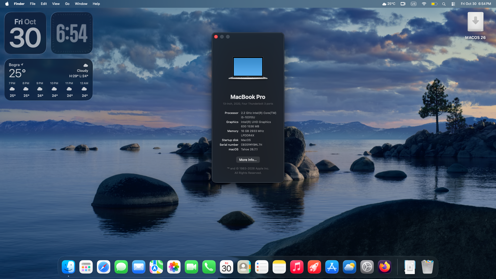

# HP EliteBook x360 1040 G7 macOS 26 Tahoe



This repository is a guide to turning the **HP EliteBook 1040 G7** into a smooth and responsive MacBook Pro-like laptop running **macOS 26 Tahoe**. It documents the setup, configuration, working hardware, known limitations.

> **Disclaimer:** This is an experimental Hackintosh project for a specific laptop configuration. Hardware revisions, BIOS settings, EFI files, and software versions can change the result. Back up important data before changing partitions or firmware. Use this guide at your own risk.

## Laptop specifications

| Component | Specification |
|---|---|
| Laptop | HP EliteBook x360 1040 G7 |
| CPU | Intel Core i5-10310U (4 cores / 8 threads 1.7-4.4 GHz) |
| Integrated graphics | Intel UHD Graphics Gen 9.5 rev 5 300-1150MHz |
| Memory | 16 GB dual-channel LPDDR4 2933MHz |
| Internal storage | 1 TB Gen 3 NVMe SSD |
| Audio | Realtek ALC285 |
| Wi-Fi / Bluetooth | Intel Wi-Fi 6 AX201 160MHz |
| Display | 14 Inch 1080p IPS Touchscreen |
| Camera | FHD Camera |
| macOS version | macOS 26.7.2 Tahoe |
| Bootloader | OpenCore 1.0.8 |
| SMBIOS | MacBookPro16,2 (2020 13 Inch Macbook Pro) |

## Hardware compatibility

This table describes the current build and is not a guarantee that every EliteBook 1040 G7 will behave identically.

| Component / feature | Status | Notes |
|---|---|---|
| macOS 26 Tahoe boot | ✅ Working | Boots using OpenCore. |
| Intel UHD graphics acceleration | ✅ Working | Graphics acceleration is enabled; macOS reports 1536 MB VRAM. |
| Built-in display | ✅ Working | Set the display color profile to **sRGB** for correct colors on this setup. |
| Touchscreen | ✅ Working | Basic touch input and Gestures work; Scrolling has to be done with two fingers |
| Internal audio / speakers | ✅ Working | The correct output appears as the second **Internal Speaker** entry in Sound settings. |
| Intel Wi-Fi | ✅ Working | Wi-Fi works from the native macOS WiFi menu. |
| Bluetooth | ✅ Working | Works. Sometimes external mice can cause problems but that's Apple's fault |
| Battery status | ✅ Working | Battery information and percentage/charging status is detected by macOS. |
| Lid close / display sleep | ✅ Working | The display turns off when the lid is closed. |
| Wake after opening lid | 🟡 Partially working | Opening the lid alone did not reliably wake the display; keyboard input could wake it. |
| Keyboard | ✅ Working | Brightness/volume keys also function perfectly |
| Trackpad and gestures | ✅ Working | Pointer movement, click, scrolling, and multi-touch gesture support. |
| Camera | ✅ Working | The camera is detected as USB hardware |
| USB-A ports | ✅ Working | Complete USB mapping works |
| USB-C / Thunderbolt | ✅ Working | Complete USB mapping works |
| HDMI / external display | 🟡 Partially working | Native HDMI port does not but USB-C to HDMI converter and Airplay works |
| Ethernet | ✅ Working  | Depends on the adapter or dock used. |
| Airplay/Airdrop | ✅ Working  | Works perfectly. |
| Sleep / standby | 🟡 Partially working  | Laptop successfully goes to sleep but waking up sometimes cause problems |
| Microphone | ⛔ Not working | Internal microphone does not work. But USB mics work |
| Fingerprint reader | ⛔ Not working | macOS does not accept any fingerprint reader other than official Apple ones |

## Installation guide

### 1. Preparation

- Confirm the exact laptop model.
- Back up personal files and create recovery/install media for existing operating systems.
- Record the current BIOS/UEFI version and settings.
- Download the required tools and files; document the source and version of each.
- This guide is for DualBooting macOS and Windows. Make sure you have at least 64GB free space on your SSD for macOS.

**Download links:**

- Download The latest MacOS.Tahoe.zip from [Releases](https://github.com/abdullihh/macos-on-hp-elitebook/releases/)
- Download [Rufus](https://rufus.ie/en/#download)

### 2. Create the installer

- Extract the **MacOS.Tahoe.zip**.
- Run the Download.bat inside the **macrecovery** folder and it should download the **com.apple.recovery.boot** folder.
- Get an USB drive and open **Rufus** while it is plugged in.
- Format the USB as **Non-bootable, FAT32 and GPT**.
- Copy the **EFI** and **com.apple.recovery.boot** folders into the root of the USB drive.

**USB structure:**

```text
USB Drive/
├── EFI/
    ├── BOOT/
    └── OC/
└── com.apple.recovery.boot/
    ├── BaseSystem.dmg
    └── BaseSystem.chunklist
```

### 3. Partition Storage

- Open Start menu and search **disk management** and press enter.
- Right click the Partition you want to shrink and select **Shrink Volume**
- Shrink it by the amount you want e.g. 131072MB for 128GB.
- Right click on the unallocated space you created and select **New Simple Volume**.
- Click next and when you get to format screen and format it as **exFAT**.

### 4. BIOS / UEFI configuration

- Restart the laptop and press **f10** repeatedly immediately when HP logo shows up. It should take to the BIOS.
- Go to **Security -> Secure Boot Configuration** and disable Secure Boot.
- Go to **Advanced -> Boot Options** then scroll down and move your USB drive to the top of boot priority.
- Press esc then save and restart and it should boot into OpenCore Boot menu.

### 5. Boot and install macOS

- **Press Space** in the OpenCore boot menu and select macOS Recovery.
- You should eventually boot into macOS recovery and select your language and connect to a WiFi by clicking on network icon on top bar.
- Open Disk Utillity and select your partition you created and format it as **APFS**.
- Select Install macOS and install it into the partition you created and it will download and install macOS.

### 6. Post-install configuration

- After it boots into the macOS setup menu set it up normally.
- If colors look weird, go to settings -> Display Settings -> Color profile and set color profile to **sRGB or generic RGB**.
- If sound dosen't work, go to audio settings and select audio device as the second **Internal Speaker** option.
- If scrolling is reversed, go to Trackpad settings and disable Natural scrolling.
- Go to settings and set sleep to never or a very long time and disable hibernation.
- MacOS Should be running now but it will only be bootable while the USB is connected.
 
### 7. Installing EFI (last step)

- Download [OC Auxiliary Tools](https://github.com/ic005k/OCAuxiliaryTools/releases)
- Open it in macOS and click on Edit -> Mount ESP then it should mount the EFI partition as NO NAME or EFI.
- Back up everything in that partition to an external USB drive before changing anything as it contains important Firmware files.
- Now copy the macOS EFI folder into your EFI partition and merge the folders.
- Now when you restart it should boot you straight to OpenCore Boot Manager instead of Windows.

**Troubleshooting**

- If the laptop fails to boot, Put your backed up original EFI into a FAT32 USB and boot from there then replace your modified EFI partition with the backup.

## Technical information

### OpenCore versions and settings

| Setting | Current value | Notes |
|---|---|---|
| macOS | macOS 26.7.2 Tahoe | Originally 26.7.1 but updated it later |
| OpenCore | 1.0.8 | Verify the version in the published EFI. |
| Configuration tool | OC Auxiliary Tools | Used Opcore simplify as the base |
| SMBIOS | MacBookPro16,2 | 2020 13 Inch Intel Macbook Pro |
| Audio layout-id | 71 | Layout for HP Spectre |
| USB mapping | USBToolBox Tool with USBToolBox kext| Mapped to 12 internal ports |

### Kernel extensions (kexts)

| Kext | Version |
|---|---|
| Lilu.kext | 1.7.3 |
| VirtualSMC.kext | 1.3.9 |
| AirportItlwm.kext | 2.4.0 |
| AppleALC.kext | 1.9.9 |
| BlueToolFixup.kext | 2.7.3 |
| BrightnessKeys.kext | 1.0.4 |
| CpuTscSync.kext | 1.1.3 |
| ECEnabler.kext | 1.0.6 |
| IntelBTPatcher.kext | 2.5.0 |
| IntelBluetoothFirmware.kext | 2.5.0 |
| NVMeFix.kext | 1.1.4 |
| RestrictEvents.kext | 1.1.7 |
| SMCBatteryManager.kext | 1.3.9 |
| SMCLightSensor.kext | 1.3.9 |
| SMCProcessor.kext | 1.3.9 |
| SMCSuperIO.kext | 1.3.9 |
| SimpleHDA.kext | 1.0.0 |
| USBToolBox.kext | 1.2.0 |
| VoodooI2C.kext/Contents/PlugIns/VoodooI2CServices.kext | 1 |
| VoodooI2C.kext/Contents/PlugIns/VoodooGPIO.kext | 1.1 |
| VoodooI2C.kext | 2.9.1 |
| VoodooI2C.kext/Contents/PlugIns/VoodooInput.kext | 1.1.7 |
| VoodooI2CHID.kext | 1 |
| VoodooPS2Controller.kext | 2.3.8 |
| VoodooPS2Controller.kext/Contents/PlugIns/VoodooInput.kext | 1.1.7 |
| VoodooPS2Controller.kext/Contents/PlugIns/VoodooPS2Keyboard.kext | 2.3.8 |
| VoodooPS2Controller.kext/Contents/PlugIns/VoodooPS2Mouse.kext | 2.3.8 |
| VoodooPS2Controller.kext/Contents/PlugIns/VoodooPS2Trackpad.kext | 2.3.8 |
| WhateverGreen.kext | 1.7.2 |
| XHCI-unsupported.kext | 0.9.2 |
| UTBMap.kext | 1.1 |

### ACPI files

| SSDT |
|---|
| SSDT-ALS0.aml |
| SSDT-SBUS.aml |
| SSDT-EC.aml |
| SSDT-GPI0.aml |
| SSDT-MCHC.aml |
| SSDT-PLUG.aml |
| SSDT-PNLF.aml |
| SSDT-USB-Reset.aml |
| SSDT-USBX.aml |
| SSDT-XOSI.aml |
| SSDT-RTCAWAC.aml |

### OpenCore drivers and tools

| EFI |
|---|
| OpenRuntime.efi |
| OpenCanopy.efi |
| OpenShell.efi |
| apfs_aligned.efi |
| HfsPlus.efi |
| ResetNvramEntry.efi |
| AudioDxe.efi |

## Credits

- [Swazen's repository](https://github.com/swazen/HP-Elitebook-x360-1040-G7-opencore-Ventura-Hackintosh) — For the CPU mask and ID
- [OpenCorePKG](https://github.com/acidanthera/opencorepkg) - For the files and drivers
- [OpenCore Simplify](https://github.com/lzhoang2801/OpCore-Simplify) - For the base EFI before many modifications and optimizations were applied
